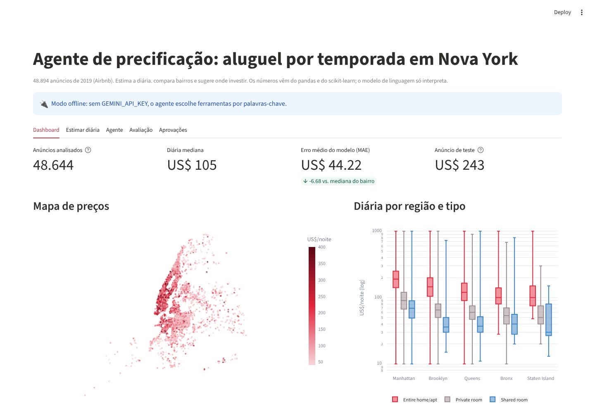
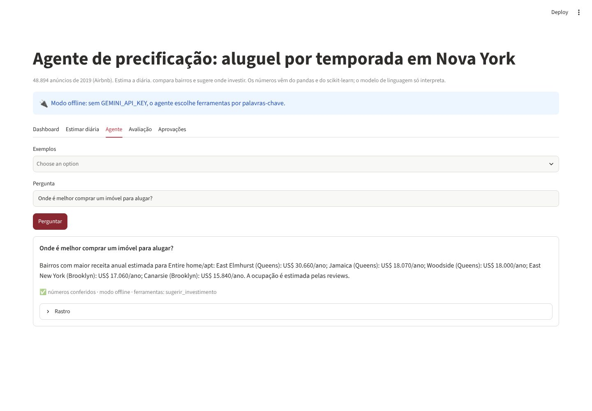

# Agente de precificação · aluguel por temporada em Nova York

Agente de IA que estima a diária de um anúncio, compara bairros, mostra o que pesa no preço e sugere onde comprar um imóvel para alugar. Usa os 48.894 anúncios de Nova York de 2019. A publicação da recomendação só acontece com aprovação humana.

O projeto começou como o desafio de precificação do programa Lighthouse (Indicium). A base é uma tradução do conjunto público *New York City Airbnb Open Data* (Inside Airbnb, 2019). O notebook e as respostas originais estão em [`docs/original/`](docs/original/).



## Como funciona
**O modelo interpreta, o código calcula e confere, a pessoa aprova.**

1. O Gemini lê a pergunta e escolhe as ferramentas, com saída em JSON Schema.
2. As consultas são filtros seguros do pandas e o modelo de preço é do scikit-learn. O modelo de linguagem não calcula nada.
3. O código confere se cada número da resposta saiu de uma ferramenta. Se algum não saiu, a resposta vira **revisar**.
4. `publicar_recomendacao` é sensível e fica pendente até ser aprovada.

Sem `GEMINI_API_KEY`, o agente roda em modo offline, com roteamento por palavras-chave.

| Ferramenta | O que faz |
|---|---|
| `estimar_preco` | Diária estimada com faixa p10–p90, a partir de bairro, tipo, mínimo de noites, disponibilidade, reviews e título |
| `prever_anuncio_teste` | Preço do anúncio de teste do desafio (*Skylit Midtown Castle*) |
| `consultar_anuncios` · `estatisticas_bairros` | Filtros e medianas por região ou bairro |
| `efeito_noites_disponibilidade` | Pergunta do desafio: mínimo de noites e disponibilidade afetam o preço? |
| `palavras_dos_caros` | Pergunta do desafio: há padrão no nome dos anúncios mais caros? |
| `explicar_preco` · `comparar_modelos` | Importância por permutação e erro em holdout |
| `sugerir_investimento` | Pergunta do desafio: onde comprar? Ranking por receita anual estimada |
| `publicar_recomendacao` | Sensível: exige aprovação |

## Resultados medidos
Holdout de 20% (9.729 anúncios, semente 42). O modelo aprende o log do preço, e o erro é medido em dólares:

| Modelo | MAE | RMSE | Erro % mediano |
|---|---|---|---|
| mediana do bairro e tipo (linha de base) | US$ 50,90 | US$ 101,08 | 25,0% |
| Ridge | US$ 47,52 | US$ 93,11 | 25,0% |
| **GBM (HistGradientBoosting)** | **US$ 44,22** | **US$ 87,52** | **22,2%** |

- **Anúncio de teste:** previsão de US$ 243,31; o preço real é US$ 225, um erro de 8,1%.
- **O que pesa no preço** (aumento do erro médio ao embaralhar): tipo de acomodação +US$ 27,58, localização +US$ 16,42, mínimo de noites +US$ 6,55 e disponibilidade +US$ 6,46.
- **Mínimo de noites e disponibilidade:** a correlação de Spearman com o preço é 0,103 e 0,083. Os efeitos existem, mas são fracos. A resposta original dizia que a correlação com o mínimo de noites era negativa, e os dados mostram o contrário.
- **Palavras dos anúncios caros:** "blueground" (uma empresa de apartamentos mobiliados) aparece em 81,2% de anúncios entre os 10% mais caros. Também se destacam "tribeca", "gym", "doorman" e "townhouse". A resposta original citava "Luxury" e "View", que não estão entre as mais associadas.
- **Onde investir (apartamento inteiro):** pela receita anual estimada, East Elmhurst (Queens, ao lado do aeroporto LaGuardia), Jamaica e Woodside. Pelo preço, Manhattan é a região mais cara, mas a ocupação estimada muda o ranking.

A avaliação contra gabarito (`python eval/run_eval.py`) acertou **20 de 20 casos**. As respostas esperadas são calculadas direto da base bruta: mediana de Manhattan, total de quartos privados no Brooklyn, a correlação de Spearman e o filtro de preços. A avaliação também cobre as metas do modelo, a consistência do ranking, 10 perguntas de roteamento e a conferência de números.

O RMSE de US$ 44 do notebook original não é comparável com este: ele foi medido depois de remover os preços altos, e aqui o teste inclui diárias de até US$ 1.000.

## Limites
- **A ocupação é estimada, não observada.** Ela vem das reviews, com a hipótese do Inside Airbnb de que 50% dos hóspedes avaliam e cada estadia dura 3 noites, limitada a 70% do ano. Bairros com hóspedes que avaliam mais parecem mais rentáveis.
- Os dados são de 2019, antes da pandemia e das regras de 2023 de Nova York que restringiram aluguéis curtos. Servem para estudo, não para decidir uma compra hoje.
- O modelo não sabe o tamanho do imóvel, as fotos nem as comodidades, e isso explica boa parte do erro restante.
- A escolha de ferramentas com o Gemini real ainda não foi medida. Para medir, rode o workflow manual `eval-gemini` com o secret `GEMINI_API_KEY`.

## Como rodar
```bash
pip install -e ".[dev]"
streamlit run app/streamlit_app.py   # dashboard, estimativa e agente
python eval/run_eval.py              # avaliação contra gabarito
pytest -q                            # testes, sem rede
```



## Estrutura
```
data/listings_nyc_2019.csv   base do desafio (48.894 anúncios)
src/aluguelagent/
  agentcore.py   cliente Gemini, laço de ferramentas, conferência de números, aprovações
  core.py        limpeza, modelo de preço, holdout, importância, consultas, palavras
  tools.py       ferramentas do agente e roteamento offline
app/streamlit_app.py   Dashboard · Estimar diária · Agente · Avaliação · Aprovações
eval/run_eval.py       gabarito
docs/original/         notebook e respostas da versão original
```
